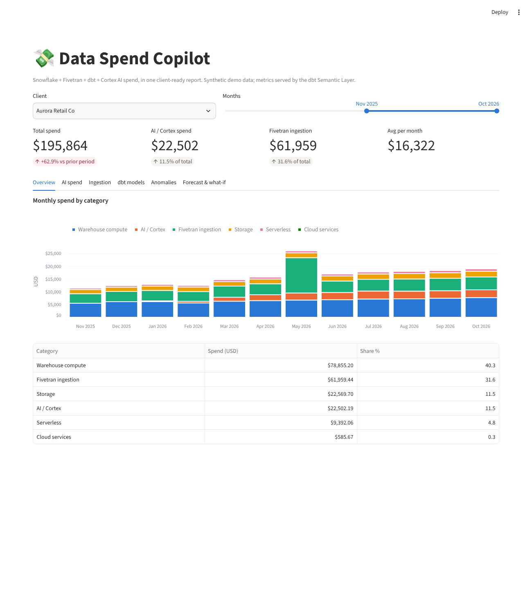
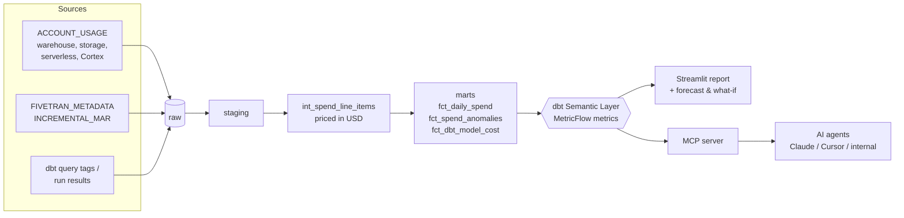
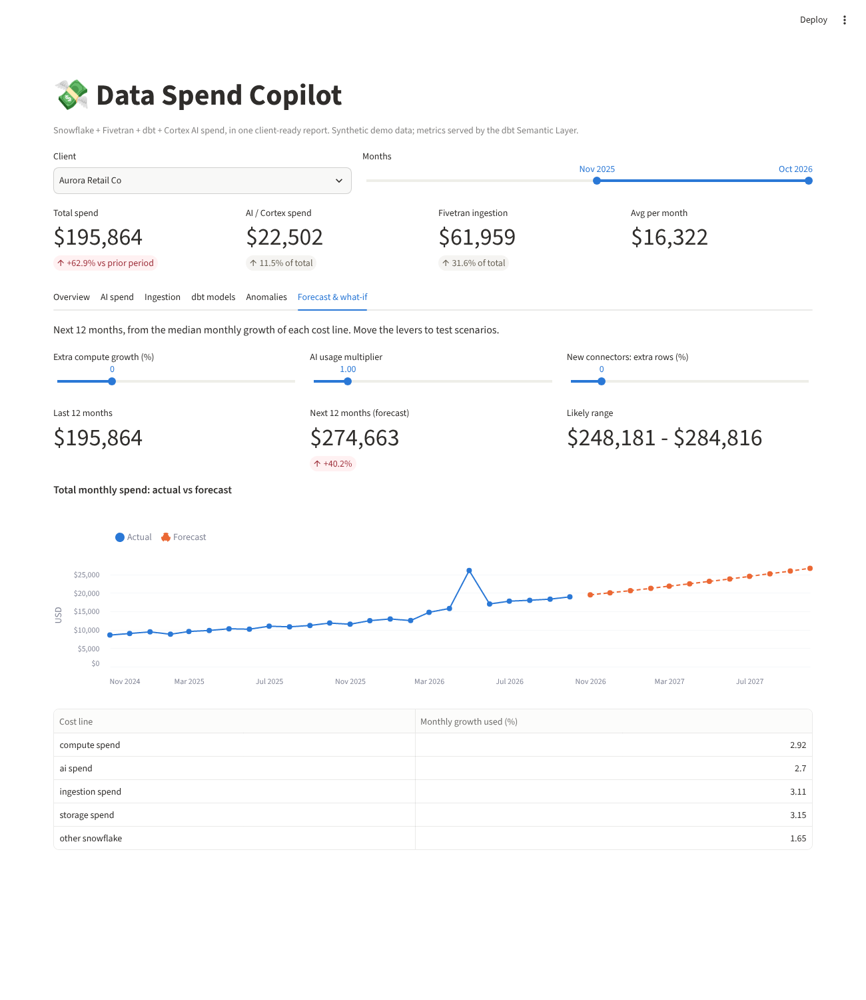

# 💸 Data Spend Copilot

**One governed view of data-platform spend (Snowflake, Fivetran, dbt and Cortex AI) that both people and AI agents can query, with a next-12-month forecast.**

Data teams now pay for four things at once: warehouse compute, ingestion (Fivetran MAR), transformation (dbt) and, increasingly, **AI** (Cortex LLM functions). Each vendor shows its own slice. Nobody shows the whole bill, and almost nobody forecasts AI spend. This project does both, and exposes the numbers to AI agents through an **MCP server** that reads from the **dbt Semantic Layer**, so "AI spend" means exactly the same thing on the dashboard and in a chatbot answer.

## What it shows

| Skill | Where |
|---|---|
| **AI / data FinOps**: unified USD cost model across Snowflake compute, billable cloud services (10% rule), storage, serverless, Cortex AI and Fivetran MAR | `dbt/models/intermediate/int_spend_line_items.sql` |
| **Semantic layer**: governed metrics (`total_spend`, `ai_spend`, `ai_share_of_spend`...) with dbt MetricFlow | `dbt/models/semantic/spend_semantic.yml` |
| **MCP server for data**: AI agents query metrics, explain month-over-month changes, list anomalies and run what-if forecasts, with row-level client scoping and no free-form SQL | `mcp_server/server.py` |
| Explainable **forecasting** with scenario levers (compute growth, AI adoption, new connectors) | `copilot/forecast.py` |
| **Anomaly detection** (28-day rolling z-score) that catches real incidents | `fct_spend_anomalies` |
| Portable: same models on **DuckDB** (free CI) and **Snowflake** | `dbt/profiles.yml`, `sql/snowflake/` |
| Tested end to end: dbt data tests, semantic-layer validation, MCP tool tests in **GitHub Actions** | `.github/workflows/ci.yml`, `tests/` |

## Architecture

## Ask it like an agent would

Connected to Claude Desktop (config in `mcp_server/claude_desktop_config.example.json`):

> **"Why did Aurora's spend jump in May 2026?"**
> → `explain_month_change` → the top mover is the `salesforce_prod` Fivetran connector: a schema change triggered a historical re-sync.

> **"Any incidents at Borealis since August?"**
> → `list_anomalies` → compute on 14–17 Aug 2026, about 3x the baseline: a warehouse left running over a long weekend.

> **"What will Cascade spend next year if AI usage doubles?"**
> → `forecast_next_12_months(ai_multiplier=2)` → next-12-month total with a likely range, by cost line.

Locking the server to one client (`COPILOT_CLIENT_SCOPE=c_cascade`) makes every tool refuse other clients' data, so it can be handed to a client.

## Design decisions

- **No double counting.** dbt model cost is an *attribution* of warehouse compute, so it lives in its own mart (`fct_dbt_model_cost`) and is never added to totals.
- **Billing-accurate cloud services.** Snowflake only bills cloud services above 10% of daily compute; the model applies that rule per account per day.
- **Metrics defined once.** The dashboard and the MCP server both go through MetricFlow; neither has its own SQL for a metric.
- **Agents never write SQL.** MCP tools take metric names and dimensions from allow-lists; inputs are validated; anomaly/dbt queries are fixed and parameterised.
- **Robust, explainable forecast.** Median month-over-month growth (one spike can't distort it), clipped to a sane range, with a 25th–75th percentile band. Simple enough to explain to a client's finance team.
- **Synthetic data with a story.** Growth, weekday seasonality, Cortex adoption S-curves and two planted incidents, so the analysis has something real to find. No employer or client data is used.

## Simplifications (on purpose)

- Fivetran is priced at a flat per-million-MAR rate; real pricing is tiered by monthly volume.
- dbt cost attribution on real accounts uses each model's share of warehouse execution time (`sql/snowflake/01_extract_raw.sql`).
- Cortex credits are priced at the account's credit rate.

## Run it

See **[HOW_TO_RUN.md](HOW_TO_RUN.md)**: everything runs free in GitHub Actions / Codespaces / Streamlit Community Cloud. No laptop needed.

## Stack

dbt Core · dbt Semantic Layer (MetricFlow) · DuckDB · Snowflake · Model Context Protocol (Python SDK) · Streamlit · Altair · pandas · GitHub Actions
